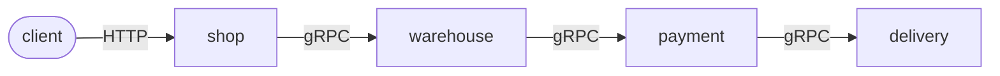
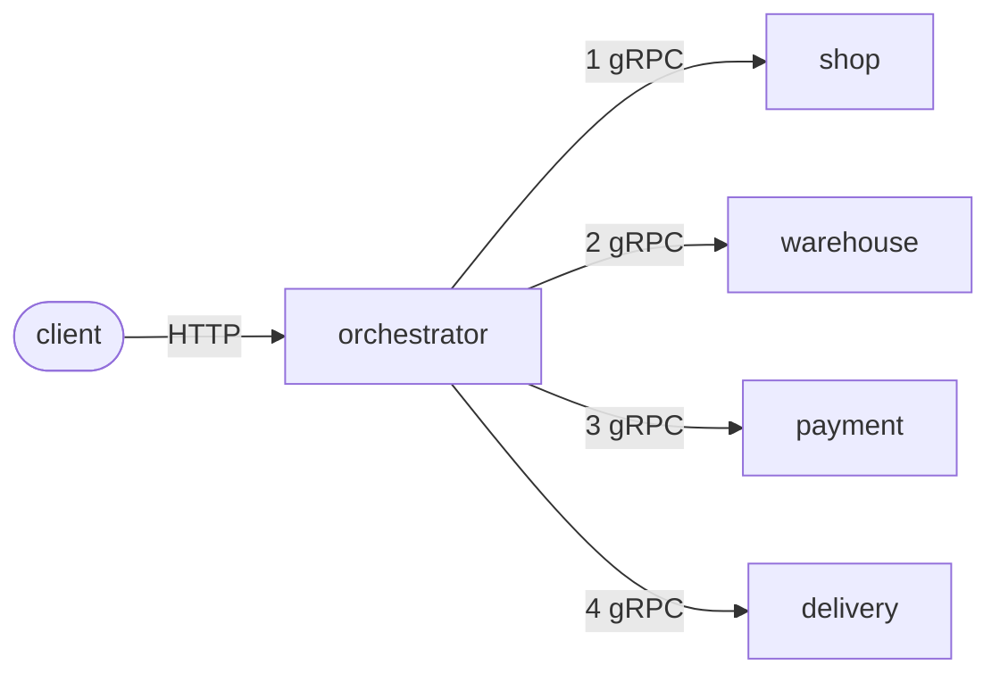
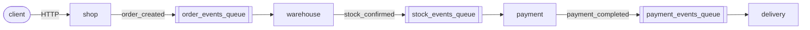
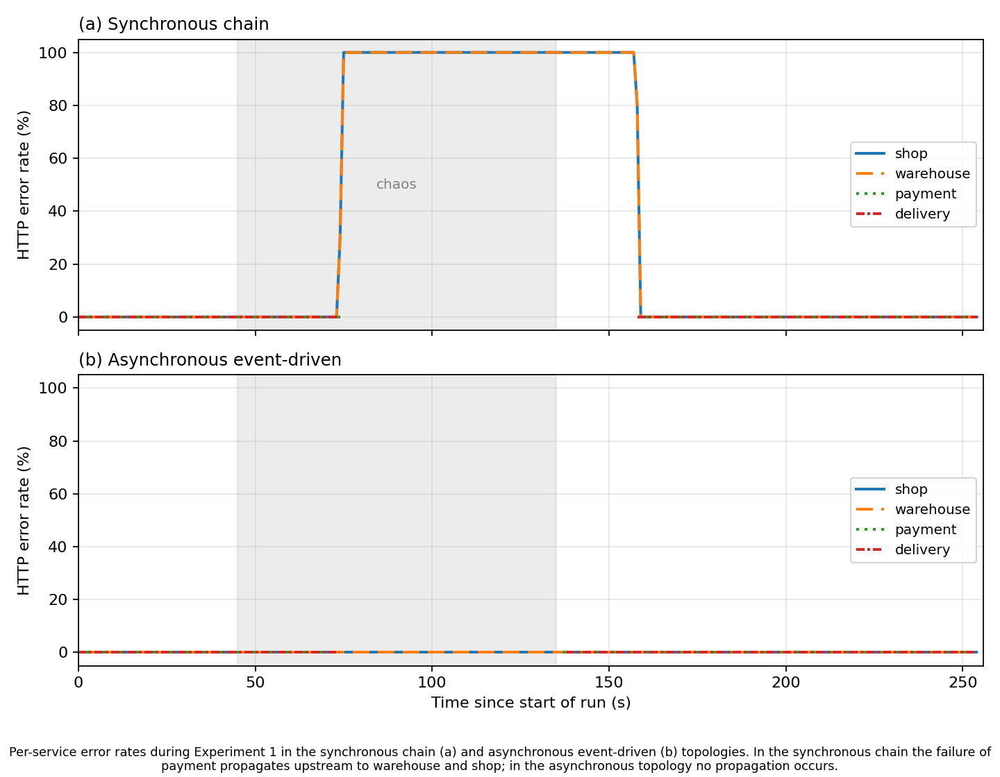

# Fault Topology Study

How does the way microservices talk to each other change what happens when one
of them fails?

This repository contains the system, infrastructure, fault-injection manifests,
load tests, analysis scripts and raw results for a thesis experiment that
answers that question empirically. The same four-service order-processing
system is deployed in three **communication topologies**. Each one is load-tested
while a service or dependency is taken down with [Chaos Mesh](https://chaos-mesh.org/),
and the results are measured from both the outside ([k6](https://k6.io/)) and the
inside ([New Relic](https://newrelic.com/) APM).

---

## The system

A car-order pipeline built from four NestJS services, each with its own
PostgreSQL database:

| Service        | Responsibility                    | HTTP | gRPC  |
| -------------- | --------------------------------- | ---- | ----- |
| `shop`         | Accepts orders (`POST /orders`)   | 3001 | 50051 |
| `warehouse`    | Checks stock                      | 3002 | 50052 |
| `payment`      | Records the payment               | 3003 | 50053 |
| `delivery`     | Schedules delivery (terminal step)| 3004 | 50054 |
| `orchestrator` | Coordinator (sync-orchestrator only) | 3005 | — |

Every service exposes `GET /health`, and `shop` also exposes `GET /orders/:id`.
The gRPC contract is in [proto/order.proto](proto/order.proto).

The topology is picked at runtime with the `TOPOLOGY` environment variable. The
code is the same in all three; only the communication path changes.

### `sync-chain`: blocking pipeline



Each hop waits for everything downstream to finish. The client gets a response
only after `delivery` has answered.

### `sync-orchestrator`: central coordinator



The orchestrator calls each service in turn and stops at the first failure.
The services never call each other.

### `async-event`: event-driven via RabbitMQ



`shop` saves the order, publishes an event and returns `201 accepted` right
away. Durable queues decouple every later hop.

---

## Experiments

All experiments run on a single-node Minikube cluster, with k6 sending a
constant **20 requests/second** to the entry service through
baseline → fault → recovery phases.

| #      | Fault (Chaos Mesh)                                     | Compares                           | Question                                                    |
| ------ | ------------------------------------------------------ | ---------------------------------- | ----------------------------------------------------------- |
| **1**  | `payment` pod down for 90 s (`pod-failure`)            | sync-chain vs async-event          | Does a mid-pipeline outage reach the user?                  |
| **2**  | `warehouse` pod down for 90 s                          | sync-chain vs sync-orchestrator    | How far does a failure spread with and without a coordinator? |
| **2b** | `delivery` (last hop) down for 90 s                    | sync-chain vs sync-orchestrator    | Same, with the worst case for the chain                     |
| **Latency** | 80 ms delay on every service pod (`NetworkChaos`) | sync-chain vs sync-orchestrator    | What is the latency cost of routing every call through a hub? |
| **3**  | Network partition `payment` ↔ `postgres` for 60 s      | sync-chain vs async-event          | How much accepted work survives a temporary dependency outage? |

### Metrics

| Metric | Definition | Source |
| --- | --- | --- |
| **Success rate under stress** | % of entry-service requests without errors during the fault window | New Relic `Transaction` |
| **Failure propagation rate** | Share of the topology's services with an error rate above 5 % during the fault | New Relic `Transaction` |
| **Propagation latency** | Time from the actual fault onset to the first user-visible error | Pod poller + New Relic `TransactionError` |
| **Recovery time (MTTR)** | Time from the failed service being Ready again to the first 5 s window at 100 % success (async: RabbitMQ backlog drained) | Pod poller + New Relic |
| **Network overhead** | Inter-service calls per business transaction | Design count, checked against New Relic spans |
| **End-to-end latency** | Client-observed `http_req_duration` | k6 |
| **Work preservation rate (WPR)** | Rows in `delivery_db.deliveries` ÷ orders k6 submitted | Postgres + k6 |

The exact NRQL query behind each metric is in
[metrics/QUERIES.md](metrics/QUERIES.md).

---

## Key results

### Experiment 1: payment outage



| Metric                  | sync-chain               | async-event               |
| ----------------------- | ------------------------ | ------------------------- |
| Success rate under stress | **0 %**                | **100 %**                 |
| Failure propagation     | 50 % (shop, warehouse)   | 0 %                       |
| Propagation latency     | ~0.8 s¹                  | never user-visible        |
| Recovery                | 24.5 s (HTTP MTTR)       | 1.6 s (queue drain)       |

¹ Below the ~1.1 s resolution of the pod poller, so effectively immediate.

### Experiments 2 and 2b: chain vs orchestrator

|                         | warehouse down: chain | warehouse down: orchestrator | delivery down: chain | delivery down: orchestrator |
| ----------------------- | --------------------- | ---------------------------- | -------------------- | --------------------------- |
| Success rate under stress | 0 %                 | 0 %                          | 0 %                  | 0 %                         |
| Failure propagation     | 25 % (shop)           | 20 % (orchestrator)          | **75 %** (shop, warehouse, payment) | **20 %** (orchestrator) |
| Recovery (MTTR)         | 105.6 s               | 24.2 s                       | 24.4 s               | 19.5 s                      |
| gRPC calls per order    | 3                     | 4                            | 3                    | 4                           |

### Latency cost of the orchestrator

Ten k6 trials per topology at 20 req/s under an 80 ms per-hop delay (mean of
the per-trial medians):

| sync-chain        | sync-orchestrator  | Difference |
| ----------------- | ------------------ | ---------- |
| 1636.0 ms (sd 1.5) | 1716.1 ms (sd 1.6) | **+80 ms** |

With no injected delay, both entry services have a server-side median of about
14 ms (New Relic, Exp 2 baseline phase).

### Experiment 3: work preservation during a DB partition

| Topology    | Runs | Mean WPR                  | HTTP requests failed |
| ----------- | ---- | ------------------------- | -------------------- |
| sync-chain  | 10   | **79.5 %** (sd 0.16 pp)   | ~20.5 %              |
| async-event | 11   | **100 %** (every run)     | 0 %                  |

In the async topology, `payment` retries the DB write with backoff while the
message stays unacked, so nothing is lost. In the sync chain, every request
that arrives during the partition fails back to the client.

---

## Repository layout

```
.
├── services/            NestJS services: shop, warehouse, payment, delivery, orchestrator
│   └── */src/nr-trace.ts    Links New Relic traces across RabbitMQ (async topology)
├── proto/order.proto    gRPC contract shared by all services
├── k8s/
│   ├── base/            postgres, rabbitmq, New Relic secret template
│   ├── sync-chain/      one manifest set per topology
│   ├── sync-orchestrator/
│   └── async-event/
├── chaos/               Chaos Mesh manifests (pod failures, partitions, network delay)
├── load-tests/          k6 scenarios in TypeScript, bundled with webpack
├── metrics/             experiment runners, NRQL tooling, statistics and plotting
│   ├── README.md        plain-language guide to the New Relic setup and output files
│   └── QUERIES.md       the NRQL query behind each metric
├── results/             raw and computed results for every run, plus charts
├── docker-compose.yml   local development stack (no chaos)
└── init-db.sh           creates the four per-service databases
```

---

## Getting started

### Prerequisites

- **Node.js 22** (the services use the New Relic agent v14)
- **Docker**
- **Minikube**, `kubectl` and **Chaos Mesh** to run the experiments
- **k6**
- **Python 3** with `matplotlib` and `scipy` for plotting and statistics
- A **New Relic** account. You need two keys: a license (ingest) key for the
  services and a User API key (`NRAK-…`) to query results

### Configuration

Create a `.env` file in the repository root. It is gitignored.

```bash
NEW_RELIC_LICENSE_KEY=...        # ingest key: lets services send data (docker compose)
NEW_RELIC_API_KEY=NRAK-...       # user key: lets metrics/nrql.mjs query data back
NEW_RELIC_ACCOUNT_ID=...         # optional, defaults to the study's account
NEW_RELIC_REGION=EU              # optional, US or EU (default EU)
```

The services run without a license key, but no APM data is collected.

### Run locally with Docker Compose

This is useful for development and quick checks. Chaos experiments need
Kubernetes.

```bash
TOPOLOGY=sync-chain docker compose up --build    # or sync-orchestrator / async-event

curl -X POST localhost:3001/orders \
  -H 'Content-Type: application/json' \
  -d '{"car_model":"Porsche 911","quantity":1,"price":45000,"customer_id":"c-1"}'
```

For `sync-orchestrator`, send the order to the orchestrator on port `3005`.
On the host, Postgres listens on `5433` and the RabbitMQ management UI is at
<http://localhost:15672>.

---

## Running the experiments on Kubernetes

### 1. Cluster setup (once)

```bash
minikube start

# Build the images inside Minikube's Docker daemon (manifests use imagePullPolicy: Never)
eval $(minikube docker-env)
for s in shop warehouse payment delivery orchestrator; do
  docker build -t "$s-service:latest" -f "services/$s/Dockerfile" .
done

# New Relic license key as a Secret (see k8s/base/newrelic-secret.yaml.example)
kubectl create secret generic newrelic --from-literal=license-key=YOUR_LICENSE_KEY

# Shared infrastructure
kubectl apply -f k8s/base/
```

Install Chaos Mesh into the cluster by following the
[Chaos Mesh installation guide](https://chaos-mesh.org/docs/production-installation-using-helm/).
Set the container runtime and socket path to match your Minikube driver.

Build the k6 scenarios:

```bash
cd load-tests && npm ci && npm run build && cd ..
```

### 2. Deploy a topology

All three topologies use the same Deployment names, so remove the current one
before you switch:

```bash
kubectl apply -f k8s/sync-chain/
# later:
kubectl delete -f k8s/sync-chain/ && kubectl apply -f k8s/async-event/
```

### 3. Run an experiment

Each runner port-forwards the entry service, runs k6 for the whole timeline,
applies and removes the chaos manifest, polls pod readiness and queue depth,
and writes everything to `results/`. All scripts run from the repository root.

**Experiment 1** (deploy each topology in turn):

```bash
CHAOS_FILE=chaos/experiment1-sustained-payment-down.yaml \
  BASELINE=45 CHAOS=90 RECOVERY=120 metrics/run-exp1.sh sync-chain

CHAOS_FILE=chaos/experiment1-sustained-payment-down.yaml \
  BASELINE=45 CHAOS=90 RECOVERY=120 metrics/run-exp1.sh async-event
```

**Experiments 2 / 2b** (use `KILL=delivery`, `LABEL=exp2b` and
`chaos/experiment2b-sustained-delivery-down.yaml` for 2b):

```bash
LABEL=exp2 KILL=warehouse CHAOS_FILE=chaos/experiment2-sustained-warehouse-down.yaml \
  BASELINE=45 CHAOS=90 RECOVERY=120 metrics/run-exp1.sh sync-chain

LABEL=exp2 KILL=warehouse ENTRY_DEPLOY=orchestrator ENTRY_PORT=3005 \
  CHAOS_FILE=chaos/experiment2-sustained-warehouse-down.yaml \
  BASELINE=45 CHAOS=90 RECOVERY=120 metrics/run-exp1.sh sync-orchestrator
```

**Latency trials:**

```bash
ENTRY_DEPLOY=shop ENTRY_PORT=3001 TOPO=sync-chain N=10 metrics/latency-trials.sh
ENTRY_DEPLOY=orchestrator ENTRY_PORT=3005 TOPO=sync-orchestrator N=10 metrics/latency-trials.sh

python3 metrics/ttest.py results/latency-trials-sync-chain.csv \
                         results/latency-trials-sync-orchestrator.csv
```

**Experiment 3** (repeat for statistical power, then aggregate):

```bash
for i in $(seq 10); do metrics/run-exp3.sh sync-chain; done
for i in $(seq 10); do metrics/run-exp3.sh async-event; done

python3 metrics/aggregate-exp3.py   # per-topology CSVs + Welch's t-test and Mann-Whitney U
```

### Output files

| File | Contents |
| --- | --- |
| `results/<exp>-<topology>-nr.json` | **Computed metrics.** These are the numbers to cite |
| `results/<exp>-<topology>-timeline.json` | Phase timestamps (baseline, fault, recovery) used to scope the NRQL queries |
| `results/<exp>-<topology>-poll.jsonl` | Per-second pod readiness and RabbitMQ queue depth |
| `results/<exp>-<topology>-k6.json` | k6 summary (the client's view) |
| `results/exp3-<topology>-<timestamp>/` | One directory per Exp 3 run: `meta.json`, `wpr.json`, `k6.json` |
| `results/latency-trials-<topology>.csv` | One row per latency trial |
| `results/chart/` | Chart data (CSV) and figures (PNG, pgfplots `.tex`) |

To query New Relic directly:

```bash
node metrics/nrql.mjs "FROM Transaction SELECT count(*) FACET appName SINCE 30 minutes ago"
```

---

## Methodology notes

- **Fault onset vs. chaos applied.** Chaos Mesh `pod-failure` takes about 30 s
  to take effect. Propagation latency is measured from when the pod actually
  went not-ready (recorded by the poller), not from when the manifest was
  applied.
- **Sustained, not flapping, faults.** An earlier variant
  (`experiment1-keep-payment-down.yaml`) killed `payment` every 10 s. It
  restarted in about 2 s, which left recovery time and propagation latency
  poorly defined. All reported runs use sustained faults instead.
- **Why the latency experiment injects delay.** Pod-to-pod traffic on
  single-node Minikube takes under a millisecond, which hides the cost of extra
  hops. The `NetworkChaos` delay adds a realistic round-trip time per hop.
- **Tracing across RabbitMQ.** gRPC traces are linked automatically by the New
  Relic agent. NestJS's RMQ transport hides message headers, so
  [`nr-trace.ts`](services/shop/src/nr-trace.ts) carries the trace context in
  an `_nr` field of the event payload. See
  [metrics/README.md](metrics/README.md#3-servicessrcnr-tracets--the-rabbitmq-trace-bridge).
- **DB timeouts.** `payment` sets 5 s query and connection timeouts. Without
  them, `pg` waits on TCP retransmits for minutes during a partition, so
  requests hang instead of failing.
- **New Relic ingest delay.** Spans are sampled and arrive 30–60 s late. The
  runners wait before they query, but if you query immediately after a run the
  numbers may be incomplete.
